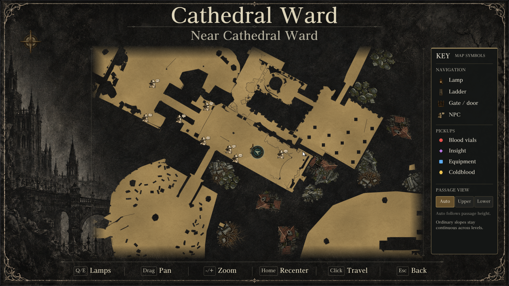
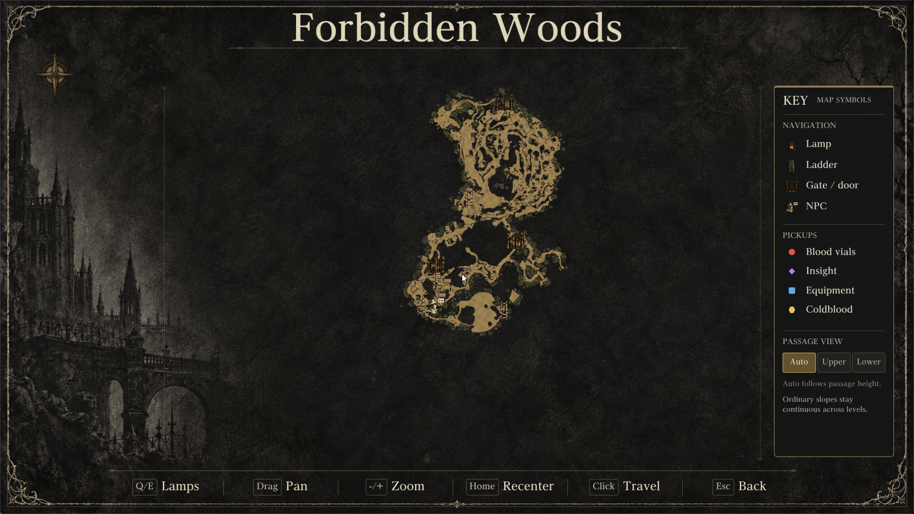

# Hunter's Atlas 3.1 + Native+ HDR

Source integration of [Hunter's Atlas](https://github.com/MikeTat1988/HuntersAtlas) by
MikeTat1988 and [Native+ HDR](https://github.com/LRF17/LanternEngine-NativePlusHDR) by LRF17.
The Lantern edition built here (`Build-Lantern.cmd`, archive
`Hunters-Atlas-3.1-Lantern-NativePlusHDR.zip`) is Atlas's Lantern 0.9.37 edition with Native+'s
HDR mode and tone mappers. How the two are combined, and Native+'s quick start:
[source/nativeplus/README.md](source/nativeplus/README.md). The Windows edition is Atlas's,
unchanged.

The rest of this page is Hunter's Atlas's own README.

# Hunter's Atlas 3.1

Choose the ZIP for the launcher you want:

| Download | Included launcher |
| --- | --- |
| [**Atlas 3.1 — Windows**](https://github.com/MikeTat1988/HuntersAtlas/releases/download/v3.1-launchers/Hunters-Atlas-3.1-Windows.zip) | Bloodborne for Windows v1.9 (Supermedo) |
| [**Atlas 3.1 — Lantern**](https://github.com/MikeTat1988/HuntersAtlas/releases/download/v3.1-launchers/Hunters-Atlas-3.1-Lantern.zip) | Atlas edition based on Awakenchan's Lantern Engine v0.9.37 |

Both include the same 16 illustrated maps, live position, navigation markers,
pan/zoom, player-height passage views and discovered-lamp travel. Each ZIP
contains its own launcher and runtime. Your existing Atlas installation can stay
in place.

## Install

1. Close the game and launchers. Extract the whole ZIP into a **new folder**.
2. Run **Install.cmd** and select your **CUSA00207 Bloodborne 1.09** game folder.
3. Select your existing **save folder containing `savedata`** and keep a backup.
4. Enable Atlas, then **Play → Continue**:
   - **Windows:** **Mods & patches → Hunter's Atlas**.
   - **Lantern:** **Settings → Hunter's Atlas 3.1 → Enable Hunter's Atlas**.
     Atlas is integrated into this edition; a separate entry in the ordinary
     Mods list is not required.
5. Open the in-game menu and select **Map**, or press **M**. For travel, select
   an eligible discovered lamp and confirm **Travel**.

[Full installation and update guide](docs/INSTALL-LAUNCHERS.md).
Game files, saves and personal launcher profiles are supplied separately.

## Updated map appearance

The center uses the map's background artwork instead of an opaque black block.
Paths use thin warm-toned edges, with a separate legend and proportionally
scaled controls.

**Cathedral Ward**

**Forbidden Woods**

The surrounding illustrations are decorative context. Navigation paths use
game-authored geometry; ordinary slopes remain continuous and actual overlapping
passages follow player height. Upper/Lower provide local passage overrides.

## Controls and updates

- Zoom with the mouse wheel, **+ / -**, or mapped controller **RT / LT**.
- Pan by dragging or using the right stick. **Home** recenters the map.
- Extract complete Atlas updates into a new folder and select the same game and
  save folders. Keep the Windows and Lantern editions in separate folders.
- The Lantern edition protects its modified Atlas runtime from stock engine
  replacement. Use a complete matching Atlas ZIP when updating it.

See [verification](docs/QA.md), [compatibility](docs/COMPATIBILITY.md), and the
[separate Windows/Lantern build commands](source/launchers/README.md).

Lantern Engine by Awaken (https://github.com/Awakenchan/LanternEngine).
The Lantern edition is modified for Hunter's Atlas and is not an official
Lantern Engine release.
